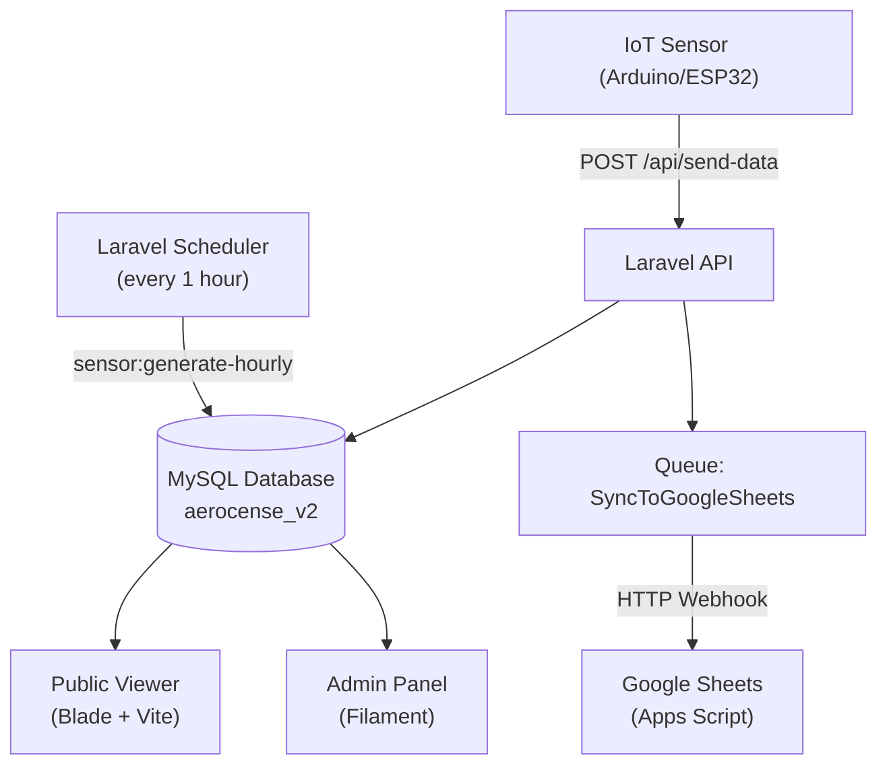

# AeroSense V2 — Project Analysis

## 🎯 Project Overview

**AeroSense V2** is a campus-wide **Air Quality Monitoring & Prediction System** built for **Universitas Diponegoro (UNDIP)**. It collects real-time environmental sensor data (CO₂, temperature, humidity) from IoT devices deployed across 12 faculties, visualizes the data through a public dashboard and an admin panel, and generates AI-powered air quality predictions.

---

## 🏗️ System Architecture



---

## 📦 What's Included

### 1. IoT Data Ingestion Layer
- **`POST /api/send-data`** — REST endpoint that accepts Arduino/ESP32 payloads
  - Supports flexible key formats: `Temp`, `temp`, `temperature`, etc.
  - Applies **1-hour throttle** per faculty to prevent duplicate readings
  - Classifies CO₂ into 3 tiers: **Baik / Sedang / Buruk**
  - Dispatches `SyncToGoogleSheets` background job after each save
- **AQI Index** computed as `min(500, co2 / 10)`

### 2. Data Models (Eloquent ORM)

| Model | Table | Key Fields |
|---|---|---|
| `Faculty` | `faculties` | `name`, `code`, `latitude`, `longitude`, `is_active` |
| `SensorReading` | `sensor_readings` | `faculty_id`, `co2`, `temperature`, `humidity`, `air_quality_status`, `aqi_index`, `recorded_at` |
| `AirQualityTrend` | `air_quality_trends` | `faculty_id`, `recorded_date`, `avg_co`, `avg_co2`, `avg_temperature`, `avg_humidity`, `avg_aqi` |
| `AirQualityPrediction` | `air_quality_predictions` | `faculty_id`, `prediction_type` (hourly/daily), `predicted_co2/temp/hum`, `confidence_score`, `model_version` |
| `EducationArticle` | `education_articles` | `title`, `slug`, `content`, `category`, `cover_image`, `is_published` |
| `User` | `users` | (standard Laravel auth) |

> **12 Faculties** seeded: FT, FEB, FH, FK, FMIPA, FPP, FISIP, FPsi, FIB, FKM, FPIK, SV

### 3. Simulation Engine (Laravel Scheduler)

The `GenerateHourlySensorReadings` Artisan command simulates realistic sensor data:

- **Runs every hour** automatically via `Schedule::command(...)->hourly()`
- Uses **per-faculty CO₂ base profiles** (e.g., SV peaks at 1050 ppm, FK is clean at 550 ppm)
- Applies a **sinusoidal time-of-day multiplier** peaking during lecture hours (08:00–14:00)
- Uses **mean-reversion drift** toward the faculty baseline + small Gaussian noise
- Supports `--backfill=N` and `--at="Y-m-d H:i"` for historical data generation

### 4. Public Viewer (Blade + Vite)

| Route | Controller | Purpose |
|---|---|---|
| `GET /` | `DashboardController` | Real-time per-faculty air quality grid |
| `GET /education` | `EducationController` | Air quality awareness articles |

- Auto-refreshes via `GET /api/sensor-readings/latest` JSON endpoint
- Color-coded status badges: `Baik` (green) / `Sedang` (yellow) / `Buruk` (red)

### 5. Admin Panel (Filament v3)

| Page / Widget | Purpose |
|---|---|
| **Dashboard** | `DashboardStatsOverview` widget + `PemantauanChartWidget` |
| **Pemantauan** (`PemantauanKualitasUdara`) | Real-time multi-faculty monitoring grid |
| **Grafik Tren Data** | Historical line chart (24h / 7d / 14d / 30d) + read-only table |
| **Prediksi Kualitas Udara** | 90-day CO₂ forecast with confidence bands |
| **Sensor Readings** (CRUD Resource) | Full Filament resource to view/manage readings |
| **Education Articles** (CRUD Resource) | Article management with publish/draft control |

- **PDF Export** of prediction reports via `barryvdh/laravel-dompdf`
- Auto-polling every 5 minutes (`$pollingInterval = '5m'`) on chart widgets

### 6. Google Sheets Integration

- `SyncToGoogleSheets` queued job forwards each sensor reading to a **Google Apps Script webhook**
- The Apps Script (`docs/google-apps-script-webhook.js`) appends rows with Indonesian timestamp format
- Configured via `GOOGLE_SHEETS_WEBHOOK_URL` in `.env`
- 3 retry attempts, 20-second timeout per attempt

### 7. Air Quality Prediction Engine

- Predictions stored in `air_quality_predictions` with `prediction_type` of `hourly` or `daily`
- Includes `model_version` field (references **XGBoost v4** in code comments)
- 90-day forecast shown with **confidence band** that widens as `confidence_score` decreases
- Status categories aligned with XGBoost v4 zone classification: **Baik / Sedang / Tidak Sehat**

---

## 🛠️ Tools & Technologies Used

### Backend Framework
| Tool | Version | Role |
|---|---|---|
| **Laravel** | ^12.0 | Core PHP framework |
| **PHP** | ^8.2 | Runtime |
| **Filament** | v3 (`*`) | Admin panel & UI components |
| **Eloquent ORM** | (Laravel built-in) | Database access layer |
| **Laravel Scheduler** | (Laravel built-in) | Hourly cron automation |
| **Laravel Queue** | (Laravel built-in) | Background job processing |
| **Laravel Http** | (Laravel built-in) | HTTP client for Google Sheets webhook |

### Frontend
| Tool | Role |
|---|---|
| **Blade** | Server-side templating |
| **Livewire** | Reactive UI (used by Filament widgets) |
| **Vite** | Asset bundling (JS + CSS) |
| **Chart.js** | Interactive line/bar charts in widgets |

### Database
| Tool | Role |
|---|---|
| **MySQL** | Primary data store (`aerosense_v2` DB) |
| **Laravel Migrations** | Schema version control |
| **Laravel Seeders** | Seed faculties, articles, predictions, users |
| **Faker** (dev) | Realistic fake data generation |

### 3rd-Party PHP Packages
| Package | Role |
|---|---|
| `filament/filament` | Admin panel framework |
| `barryvdh/laravel-dompdf` | PDF generation (prediction reports) |
| `laravel/tinker` | REPL for debugging |
| `laravel/sail` (dev) | Docker-based local dev |
| `laravel/pint` (dev) | PHP code style fixer |
| `phpunit/phpunit` (dev) | Testing framework |
| `nunomaduro/collision` (dev) | CLI error formatting |

### External Integrations
| Tool | Role |
|---|---|
| **Arduino / ESP32** | IoT sensor hardware (data source) |
| **Google Sheets** | Secondary data logging via Apps Script |
| **Google Apps Script** | Webhook receiver deployed as Web App |

### Design & Methodology

| Aspect | Details |
|---|---|
| **Architecture pattern** | MVC (Model-View-Controller) with Repository-like scopes |
| **API design** | REST (JSON), CSRF-exempt for IoT endpoint |
| **Data simulation** | Mean-reversion stochastic model with sinusoidal daily cycle |
| **Air quality classification** | CO₂-based 3-tier: 400–1000 ppm (Baik), 1001–2000 (Sedang), 2001–5000 (Buruk) |
| **ML model** | XGBoost v4 (referenced in code; predictions stored, not computed live) |
| **Timezone** | `Asia/Jakarta` (WIB, UTC+7) |
| **Composite DB index** | `(faculty_id, recorded_at)` for fast latest-per-faculty queries |
| **Throttling** | 1-hour per-faculty rate limit on IoT endpoint |
| **Auto-refresh** | 5-minute polling interval on Livewire chart widgets |

---

## 🗂️ Project Structure Summary

```
aerosense-v2/
├── app/
│   ├── Console/Commands/GenerateHourlySensorReadings.php  ← Simulation engine
│   ├── Filament/
│   │   ├── Pages/     ← GrafikTrenData, PemantauanKualitasUdara, PrediksiPage
│   │   ├── Resources/ ← EducationArticles, SensorReadings (CRUD)
│   │   └── Widgets/   ← DashboardStats, PemantauanChart, PemantauanStats
│   ├── Http/Controllers/
│   │   ├── Api/       ← SensorDataController (IoT ingest)
│   │   └── Viewer/    ← DashboardController, EducationController, PredictionController
│   ├── Jobs/SyncToGoogleSheets.php  ← Background sync job
│   └── Models/        ← Faculty, SensorReading, AirQualityTrend, AirQualityPrediction, EducationArticle
├── database/
│   ├── migrations/    ← 10 migration files
│   └── seeders/       ← 7 seeders incl. FacultySeeder, AirQualityPredictionSeeder
├── docs/
│   └── google-apps-script-webhook.js  ← Google Sheets integration script
├── routes/
│   ├── api.php        ← POST /send-data, GET /sensor-readings/latest
│   ├── web.php        ← Public viewer + admin PDF route
│   └── console.php    ← Hourly scheduler definition
└── image/             ← aerosenselogo.png, hero-campus.png, weather.png
```
